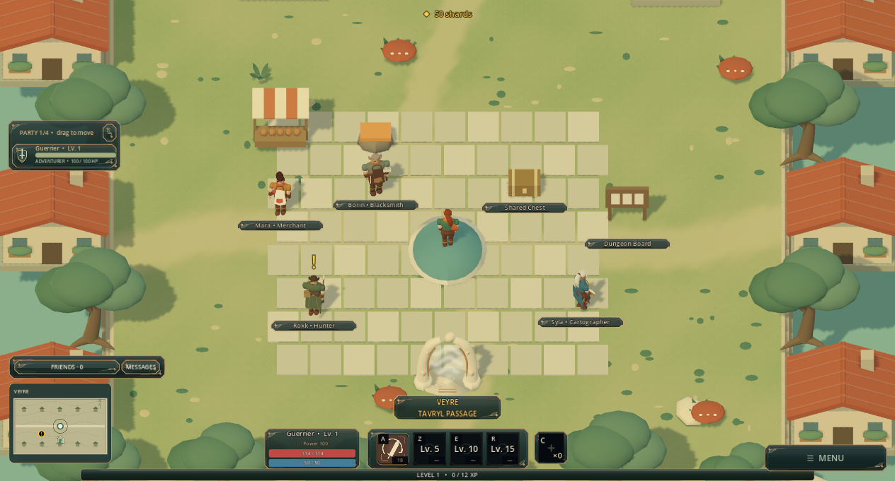

# Tavryl — Early beta / Première bêta

**Windows · Français / English · Free, unpaid playtest / Test gratuit et bénévole**

[Download Windows 0.18.2](https://github.com/hugoschlappi14-ctrl/tavryl-beta/releases/download/v0.18.2/Tavryl-0.18.2-Windows.zip) · [Release notes](https://github.com/hugoschlappi14-ctrl/tavryl-beta/releases/tag/v0.18.2) · [Discord FR / EN](https://discord.gg/BCrvrPKNCR)

## Français

Tavryl est un action-RPG fantasy indépendant en développement. Crée ton personnage, choisis ta classe, explore plusieurs mondes, débloque tes sorts au fil des niveaux et fais évoluer ton équipement visible sur ton personnage.

- **Guerrier** : combat de proximité.
- **Arcaniste** : magie offensive.
- **Pisteur** : assassin de mêlée.
- **Tisseur** : soutien.

### Jouer maintenant

Le **solo et la coopération en ligne** sont disponibles. Le serveur Render fonctionne indépendamment du PC du créateur. Quatre clients automatisés ont validé les quatre classes, le groupe, les combats, récompenses, quêtes et soins sur Internet ; les retours de vrais joueurs restent nécessaires.

1. Télécharge **Tavryl-0.18.2-Windows.zip** avec le lien ci-dessus.
2. Extrais les quatre fichiers dans le même dossier, puis ouvre **Tavryl.exe**.
3. Choisis ta langue sur l'accueil et crée un personnage dans un emplacement **+**.
4. Les réglages graphiques, le compteur FPS et les commandes sont accessibles en jeu. Un profil QWERTY est disponible.
5. Après le choix de classe, saisis une seule fois le code bêta du salon télécharger-download sur Discord. Les prochaines connexions seront automatiques. Le statut en haut de l’écran permet de réessayer ou de choisir le solo. Ajoute tes amis pour former un groupe de quatre.

Déplacement : clic droit ou ZQSD par défaut. Attaque de base : Espace. Premier sort : A. Dialogue et acceptation de quête : F. Tu peux modifier les touches.

### Aide-nous avec 30 à 45 minutes de jeu

Nous cherchons environ dix volontaires, débutants ou habitués des RPG. Le test est gratuit et non rémunéré ; aucun achat demandé. Les retours écrits suffisent, sans obligation d'enregistrer ta partie.

Sur le [Discord Tavryl](https://discord.gg/BCrvrPKNCR), indique ta langue et la classe qui t'intéresse. Raconte le premier moment de confusion, un combat trop facile ou trop difficile, et ce qui t'a donné envie de continuer ou d'arrêter. Tu peux aussi [ouvrir un signalement](https://github.com/hugoschlappi14-ctrl/tavryl-beta/issues).

**Limites actuelles :** bêta Windows non signée ; progression conservée sur ton PC, sans sauvegarde cloud ; Ascensions et contrats d'expédition en solo. Render peut demander environ une minute de réveil après inactivité et ses quotas gratuits s'appliquent. La base gratuite expire le **5 décembre 2026** : une migration sera nécessaire avant cette date. Aucun abonnement payant activé. Si Windows ou ton antivirus affiche une alerte, signale-la sans désactiver tes protections.

## English

Tavryl is an independent fantasy action RPG in development. Customize your character, choose a class, explore several worlds, unlock skills as you level up and collect equipment that changes your appearance.

The four classes are **Warrior**, **Arcanist**, **Tracker** (a melee assassin) and **Weaver** (support).

### Play now

**Solo and online co-op are available.** The Render server does not depend on the creator's PC. Four automated clients validated all four classes, parties, combat, rewards, quest credit and healing over the Internet; feedback from real players is still needed.

1. Download **Tavryl-0.18.2-Windows.zip** using the link at the top.
2. Extract all four files into one folder and open **Tavryl.exe**.
3. Choose **English** on the title screen and use a **+** slot to create a character.
4. Open Settings / Controls for the **QWERTY preset** or custom bindings. Graphics and the live FPS counter can also be adjusted.
5. After choosing your class, enter the beta code from the Discord télécharger-download channel once. Future connections are automatic. Click the connection status at the top to retry or choose solo. Add friends to form a party of four.

Right-click to move. Space is the default basic attack and F opens dialogue and accepts quests. Spell keys can be changed in Controls.

### A 30–45 minute first playtest

We are looking for about ten volunteer testers. Testing is free and unpaid, with no purchase required. Written feedback is enough; recording is optional. Newcomers and experienced RPG players are welcome.

Join [Tavryl on Discord](https://discord.gg/BCrvrPKNCR) and share your preferred language and class. Tell us where you first felt confused, which combat felt too easy or too hard, and what made you want to keep playing or stop. You can also [report an issue here](https://github.com/hugoschlappi14-ctrl/tavryl-beta/issues).

**Current limits:** unsigned Windows beta; saves are local, without cloud synchronization; Ascensions and expedition contracts remain solo activities. Render may take about a minute to wake after inactivity and free quotas apply. The free database expires on **December 5, 2026** and needs migration before then. No paid subscription enabled. If Windows or your antivirus shows a warning, report it without disabling protection.

---

Development uses AI-assisted tools. Images on this page are screenshots from the game. This repository contains the beta download and player information; it is not the game's source repository.

### Connection and privacy / Connexion et suivi

**FR :** si le serveur se réveille, est complet ou indisponible, le jeu reste jouable en solo. Le serveur conserve les identités réseau, amis, personnages vus en ligne et connexions pour le suivi de bêta et la modération. Le créateur ne voit pas les personnages et sessions entièrement hors ligne.

**EN:** enter the beta code from télécharger-download on Discord once, after choosing your class. Future connections are automatic. Click the connection status at the top to retry or choose solo. If the server is waking, full or unavailable, solo remains playable. The server stores network identities, friends, characters seen online and connections for beta tracking and moderation. Fully offline characters and sessions are not visible to the creator.
